# CineVote — Movie Voting App on AWS

A three-tier, containerised web application deployed on AWS EC2 across three subnets, built and
released through a GitHub Actions pipeline with OIDC-authenticated deploys, and observed with
CloudWatch logs, metrics and email alarms.

Guide authors: **@Freeman** — *Movie Voting App on AWS* (Oct 4, 2026) and
*CineVote CI/CD Pipeline: GitHub Actions* (Oct 8, 2026).

> **Looking at the images:** every screenshot in this README lives in `assets/` beside this file.
> Keep `README.md` and the `assets/` folder together at the repository root and the images render.

---

## Table of contents

- [1. What CineVote is](#1-what-cinevote-is)
- [2. Project objectives](#2-project-objectives)
- [3. Features](#3-features)
- [4. How one vote travels](#4-how-one-vote-travels)
- [5. Architecture](#5-architecture)
  - [5.1 Full architecture](#51-full-architecture)
  - [5.2 Only Nginx faces the internet](#52-only-nginx-faces-the-internet)
  - [5.3 Why three instances](#53-why-three-instances)
  - [5.4 Every connection, and what makes it work](#54-every-connection-and-what-makes-it-work)
  - [5.5 Network and security groups](#55-network-and-security-groups)
- [6. Tech stack](#6-tech-stack)
- [7. AWS services used](#7-aws-services-used)
- [8. Project structure](#8-project-structure)
- [9. Configuration and secrets](#9-configuration-and-secrets)
- [10. Running the stack](#10-running-the-stack)
  - [10.1 Start, verify, stop](#101-start-verify-stop)
  - [10.2 The command pattern](#102-the-command-pattern)
  - [10.3 The one-minute whole-system check](#103-the-one-minute-whole-system-check)
- [11. Deployment to AWS](#11-deployment-to-aws)
- [12. CI/CD pipeline](#12-cicd-pipeline)
  - [12.1 Pipeline design](#121-pipeline-design)
  - [12.2 Box by box](#122-box-by-box)
  - [12.3 Four decisions, and why](#123-four-decisions-and-why)
  - [12.4 Secrets and variables](#124-secrets-and-variables)
  - [12.5 Evidence: a green run](#125-evidence-a-green-run)
  - [12.6 Evidence: the deploy on the servers](#126-evidence-the-deploy-on-the-servers)
- [13. Security](#13-security)
- [14. Monitoring, logs and alarms](#14-monitoring-logs-and-alarms)
  - [14.1 Health checks](#141-health-checks)
  - [14.2 CloudWatch logs and metrics](#142-cloudwatch-logs-and-metrics)
  - [14.3 Alarms and email](#143-alarms-and-email)
- [15. API and health endpoints](#15-api-and-health-endpoints)
- [16. Testing](#16-testing)
- [17. Everyday use](#17-everyday-use)
- [18. Application walkthrough](#18-application-walkthrough)
  - [18.1 The voter's view](#181-the-voters-view)
  - [18.2 The admin view](#182-the-admin-view)
- [19. Troubleshooting](#19-troubleshooting)
- [20. Cost and cleanup](#20-cost-and-cleanup)
- [21. Screenshot index](#21-screenshot-index)

---

## 1. What CineVote is

**Type:** a weekly movie-voting web application — a public ballot backed by a Redis queue, a Node.js
worker and PostgreSQL, running in containers on three EC2 instances inside one VPC.

**Purpose:** CineVote is both a working product and a reference implementation of a production-shaped
AWS deployment. The application half gives a group of people a fair, once-a-week vote on what to
watch — one vote per person per week, a live leaderboard, and a record of past winners. The
infrastructure half demonstrates subnet isolation, least-privilege IAM, private-only data tiers, and a
pipeline that tests every change before it reaches `main`.

Weeks follow the **ISO calendar** and roll over every **Monday 00:00 UTC**. Last week's winner becomes
the site's "Recommended watch", and past winners accumulate into a Hall of Fame.

---

## 2. Project objectives

| # | Objective | How it is met |
|---|-----------|---------------|
| 1 | One real application, three tiers | Frontend, backend and database each on their own EC2 instance in their own subnet |
| 2 | Exactly one public entry point | Only Nginx has a public IP; it is the sole inbound path |
| 3 | Subnets and security groups must isolate something | The app tier accepts 5000 from the frontend group only; the data tier accepts 5432 from the backend group only |
| 4 | Data must outlive containers | PostgreSQL keeps its files on a separate 10 GiB EBS disk at `/data` |
| 5 | Never lose a vote | Votes sit in a Redis list if PostgreSQL is down; the worker saves them when it returns |
| 6 | Automate test, build, push and deploy | GitHub Actions: flake8/ESLint, pytest/Jest, Docker build, Docker Hub push, SSH deploy, smoke test |
| 7 | Make rollback possible | Images are tagged with the commit ID — never `latest` — and a failed smoke test switches back to the previous tag automatically |
| 8 | No stored AWS keys | GitHub signs in to AWS with OIDC and receives temporary credentials that expire after an hour |
| 9 | Keep SSH closed | Port 22 on the frontend opens only for the runner's own IP during a deploy, and closes again even if the deploy fails |
| 10 | Keep secrets off GitHub | Passwords live only in server-side `.env` files, which `.gitignore` blocks |
| 11 | Know when something breaks | Docker healthchecks on all five containers, a custom unhealthy-container metric per server, and alarms that email you |
| 12 | Learn every piece by building it | All AWS resources are created by clicking in the console, in dependency order |

---

## 3. Features

**Accounts and voting**

- Users register and log in — passwords hashed with Werkzeug, HTTP-only session cookies, CSRF-protected forms
- One vote per user per week, enforced three separate times: a PostgreSQL lookup, an atomic Redis marker key, and the worker's insert constraint
- Live leaderboard with a **10-second Redis cache**, falling back to a PostgreSQL query on a miss
- Last week's winner is surfaced as the "Recommended watch"; past winners form the Hall of Fame
- Ballot of 8 seeded movies

**Admin dashboard** — restricted to admin users (`/admin` returns **403 Forbidden** to everyone else)

- Users, votes cast this week, turnout
- Votes currently waiting in the Redis queue
- Votes-per-week chart
- Recent votes
- Add new movies, or hide existing ones

**Interface**

- Light and dark mode with a toggle, remembered in the browser
- Fade-in cards, animated leaderboard bars, count-up numbers, and confetti after voting
- "Your pick" marking on the voted card, with the other vote buttons disappearing

**Platform**

- Healthchecks on all five containers; `restart` policies bring everything back after a crash or reboot
- An end-to-end `/health` check on the frontend that only returns 200 when the request travels Nginx → Flask → Redis **and** PostgreSQL and back
- Container logs shipped to CloudWatch via the `awslogs` driver
- A cron-driven custom metric counting unhealthy containers on each server
- Alarm-to-email alerting through SNS

---

## 4. How one vote travels

1. The browser sends the request to **Nginx** on the frontend server (public subnet, port 80).
2. Nginx forwards it to **Flask** on the backend server's private IP, port 5000.
3. Flask checks PostgreSQL and a Redis marker key to confirm you have not already voted this week. It
   pushes the vote as JSON onto the Redis **`votes` list** with `LPUSH`, and replies at once.
4. The **Node.js worker** (same backend server) pops votes off the list with `BRPOP`, inserts each into
   PostgreSQL on the database server (port 5432), then deletes the cached leaderboard key.
5. PostgreSQL keeps its files in `/data`, a separate 10 GiB EBS disk, so the data survives even if the
   container is rebuilt.
6. For the leaderboard, Flask reads Redis first. If the key is missing, it queries PostgreSQL and
   stores the result in Redis for 10 seconds.

Flask pushes with `LPUSH` (adds on the left) and the worker pops with `BRPOP` (takes from the right),
so votes are processed in arrival order. `BRPOP` blocks: the worker sleeps inside Redis until a vote
arrives or 5 seconds pass, so it uses almost no CPU while idle.

**Redis never talks to PostgreSQL.** Flask talks to both; the worker talks to both. Flask reads users,
movies and results from PostgreSQL. Flask writes to PostgreSQL only for new accounts and admin movie
changes — **it never inserts votes**.

---

## 5. Architecture

### 5.1 Full architecture

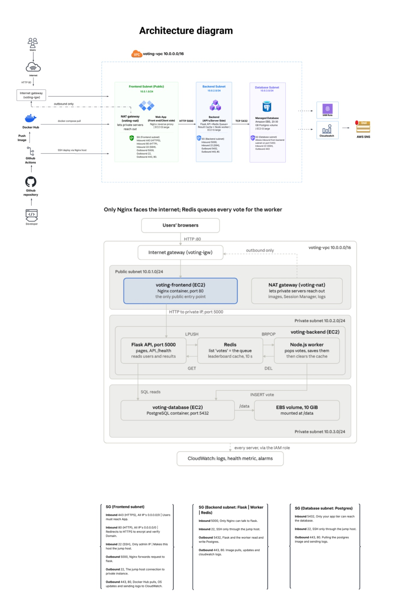

*Figure 1 — The full system: one VPC, three subnets, three servers, five containers. Solid arrows carry
app traffic; dashed arrows are outbound-only.*

### 5.2 Only Nginx faces the internet


*Figure 2 — The same topology, reduced to the request path. The caption in the source diagram states
the rule the whole design rests on: **only Nginx faces the internet; Redis queues every vote for the
worker.***

*(Figures 1 and 2 are the two drawings on the same source page — the detailed view and the simplified
one. If you want them as separate crops, say so.)*

### 5.3 Why three instances

Three instances, one per subnet tier — the smallest setup where subnets and security groups actually
isolate something.

| Server | Subnet | Containers | Who may connect in | Public IP |
|--------|--------|-----------|--------------------|-----------|
| `voting-frontend` | public | nginx | anyone, port 80 | yes |
| `voting-backend` | private | flask, redis, worker | frontend server only, port 5000 | no |
| `voting-database` | private | postgres (+ 10 GiB data disk) | backend server only, port 5432 | no |

Redis sits on the backend server next to Flask and the worker. They reach it over Docker's internal
network by the service name `redis`, so **port 6379 is never exposed to the VPC at all**.

One instance would make the subnets pointless; more than three adds cost without teaching anything new.
All three subnets share one Availability Zone (us-east-1a) to keep it simple and cheap.

A production version would add a second Availability Zone, a load balancer, and managed services
(RDS, ElastiCache) — out of scope on free credits.

### 5.4 Every connection, and what makes it work

| From → To | Address used | Port | Written in | Port opened by | Allowed by |
|-----------|--------------|------|-----------|----------------|------------|
| Browser → Nginx | frontend public IP | 80 | your browser | frontend compose | anyone |
| Nginx → Flask | backend private IP | 5000 | backend compose | `voting-backend-sg` | `voting-frontend-sg` |
| Flask → Redis | `redis` | 6379 | backend compose | nothing — same Docker network | not needed, never leaves the server |
| Worker → Redis | `redis` | 6379 | backend compose | nothing — same Docker network | not needed |
| Flask → PostgreSQL | database private IP | 5432 | database compose | `voting-database-sg` | `voting-backend-sg` |
| Worker → PostgreSQL | database private IP | 5432 | database compose | `voting-database-sg` | `voting-backend-sg` |
| Private servers → internet | NAT gateway | 443 | — | outbound rules | outbound 443 and 80 in every SG |
| Docker, cron → CloudWatch | AWS endpoints | 443 | compose files, health script | — | outbound 443 |

Between subnets, the `local` route that every route table contains delivers packets automatically —
server-to-server routing is never configured by hand.

This table is also why the build order is fixed: you need the database's private IP before writing the
backend's `.env`, and the backend's private IP before writing the frontend's. So: **database → backend
→ frontend**.

### 5.5 Network and security groups

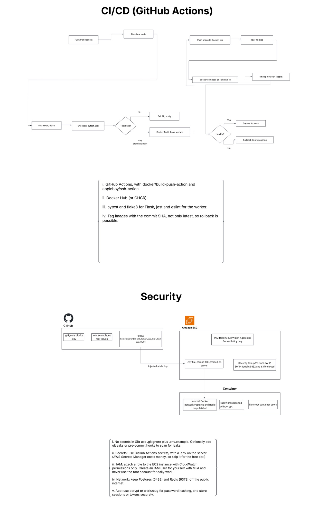

*Figure 3 — Security groups, one per tier (lower half of the source page; the CI/CD flow is covered in
[Section 12](#12-cicd-pipeline)).*

Your NSG design becomes three AWS security groups. In AWS a security group attaches to the **server**
rather than the subnet, is **stateful** (replies are allowed back automatically), has **allow rules
only**, and a rule's source or destination can be another security group.

**`voting-frontend-sg`** — public subnet: Nginx + SSH jump host

| Direction | Type | Port | Source / destination | Purpose |
|-----------|------|------|---------------------|---------|
| Inbound | HTTP | 80 | `0.0.0.0/0` | Users reach the app |
| Inbound | HTTPS | 443 | `0.0.0.0/0` | Served once a certificate is installed |
| Inbound | SSH | 22 | My IP | Only the admin reaches the jump host |
| Outbound | Custom TCP | 5000 | `voting-backend-sg` | Nginx forwards requests to Flask |
| Outbound | SSH | 22 | `voting-backend-sg` | Jump host → backend server |
| Outbound | SSH | 22 | `voting-database-sg` | Jump host → database server |
| Outbound | HTTPS | 443 | `0.0.0.0/0` | Docker Hub pulls, OS updates, CloudWatch logs, Session Manager |
| Outbound | HTTP | 80 | `0.0.0.0/0` | Package mirrors that use plain HTTP |

**`voting-backend-sg`** — private subnet: Flask, worker, Redis

| Direction | Type | Port | Source / destination | Purpose |
|-----------|------|------|---------------------|---------|
| Inbound | Custom TCP | 5000 | `voting-frontend-sg` | Only Nginx can talk to Flask |
| Inbound | SSH | 22 | `voting-frontend-sg` | SSH only through the jump host |
| Outbound | PostgreSQL | 5432 | `voting-database-sg` | Flask and the worker read and write PostgreSQL |
| Outbound | HTTPS | 443 | `0.0.0.0/0` | Image pulls, pip and npm installs, CloudWatch, Session Manager |
| Outbound | HTTP | 80 | `0.0.0.0/0` | Package mirrors that use plain HTTP |

**`voting-database-sg`** — private subnet: PostgreSQL

| Direction | Type | Port | Source / destination | Purpose |
|-----------|------|------|---------------------|---------|
| Inbound | PostgreSQL | 5432 | `voting-backend-sg` | Only the app tier can reach the database |
| Inbound | SSH | 22 | `voting-frontend-sg` | SSH only through the jump host |
| Outbound | HTTPS | 443 | `0.0.0.0/0` | Pulling the PostgreSQL image, CloudWatch logs, Session Manager |
| Outbound | HTTP | 80 | `0.0.0.0/0` | Package mirrors that use plain HTTP |

**Why these rules are enough**

- **Replies need no rules.** Security groups are stateful: when Nginx's request is allowed into Flask
  on 5000, Flask's reply goes back automatically.
- **Redis has no rule** because it never leaves the backend server; Flask and the worker reach it
  inside Docker.
- **DNS, the instance metadata service and time sync** are not filtered by security groups, so the
  restricted outbound rules do not break them.
- **Outbound 443 is load-bearing.** It keeps Session Manager (your browser terminal), CloudWatch, Docker
  Hub, pip and npm working through the NAT gateway. If any of those hangs, check this rule first.
  Outbound 80 matters too: Ubuntu's apt mirrors on EC2 use plain HTTP, so **apt fails without it**.
- **Port 443 inbound is open but nothing listens on it** until you add a domain and certificate.
  An HTTPS attempt is refused; the app is served on HTTP.
- **"My IP" can change.** Home and mobile connections often get a new public IP. If SSH to the frontend
  suddenly times out, edit the inbound SSH rule and choose My IP again.
- **To drop the jump host later** and use only Session Manager, delete every SSH rule in the three
  groups. Nothing else changes.

Leave the subnets' network ACLs at their default.

---

## 6. Tech stack

| Layer | Technology | Notes |
|-------|-----------|-------|
| Front end | Nginx (Alpine) | Serves the app, reverse-proxies to Flask; template rendered at container start |
| API | Python 3.12, Flask, Gunicorn | Pinned versions in `requirements.txt`; logs unbuffered so they reach CloudWatch immediately |
| Queue and cache | Redis | `votes` list as the queue; leaderboard cached for 10 s |
| Worker | Node.js 20 | `BRPOP` loop; tolerant of malformed votes |
| Database | PostgreSQL 16 (Alpine) | Pinned major version; data on the EBS disk |
| Containers | Docker Engine, Compose v2, Buildx | Compose uses Buildx to build images |
| CI/CD | GitHub Actions | `docker/build-push-action`, `appleboy/ssh-action`, OIDC to AWS |
| Registry | Docker Hub | Two public repos: `cinevote-flask`, `cinevote-worker` |
| Cloud | AWS — EC2 `t3.micro`, VPC, IGW, NAT gateway, EBS, IAM | us-east-1 |
| Monitoring | CloudWatch (logs, metrics, alarms), SNS, AWS CLI | AWS CLI installed as a snap for the health metric script |
| OS | Ubuntu Server 24.04 LTS (x86) | Docker installed by the launch script |

---

## 7. AWS services used

| Service | Purpose in this project |
|---------|------------------------|
| **Amazon VPC** (`voting-vpc`, `10.0.0.0/16`) | Your own isolated network — 65,536 private addresses |
| **Subnets** | `voting-public-subnet` (10.0.1.0/24), `voting-private-backend-subnet` (10.0.2.0/24), `voting-private-db-subnet` (10.0.3.0/24) |
| **Internet gateway** (`voting-igw`) | The VPC's front door to the internet — a VPC can have only one |
| **NAT gateway** (`voting-nat`) | Outbound-only internet for private servers: image pulls and log shipping |
| **Route tables** | `voting-public-rt` (→ IGW) and `voting-private-rt` (→ NAT) |
| **Amazon EC2** | Three `t3.micro` Ubuntu 24.04 instances, one per subnet |
| **Amazon EBS** | 10 GiB gp3 volume mounted at `/data` for PostgreSQL |
| **AWS IAM** | One role for the servers (Session Manager + CloudWatch) and one OIDC deploy role for GitHub |
| **Amazon CloudWatch** | Log groups, a custom unhealthy-container metric, alarms, Logs Insights |
| **Amazon SNS** | Email alerts for alarms |
| **AWS Systems Manager** | Session Manager browser terminals — SSH-free access to all three servers |
| **Docker Hub** | Stores commit-tagged images the backend pulls from |
| **GitHub Actions** | Lint, test, build, push, deploy, smoke test, rollback |

**What it costs on your credits** (us-east-1 on-demand, if left running 24/7)

| Item | Rate | Per month |
|------|------|-----------|
| NAT gateway | $0.045/hour + $0.045 per GB processed | about $33 |
| 3 × t3.micro EC2 | $0.0104/hour each | about $23 |
| 2 public IPv4 addresses (NAT + frontend) | $0.005/hour each | about $7 |
| EBS gp3, 34 GB total | $0.08 per GB-month | about $3 |
| CloudWatch (logs, 6 custom metrics, 4 alarms) | within the free tier at this size | about $0 |

The NAT gateway is more than half the bill, which is why [Section 19](#19-cost-and-cleanup) shows how
to delete it when you are not working and recreate it in two minutes.

---

## 8. Project structure

Each server runs its **own** Docker Compose file — Compose only manages containers on the machine it
runs on, so there are three independent stacks.

### 8.1 Before CI/CD — the project as it runs on the server

This is the backend server's folder exactly as the deployment guide leaves it. Everything the app needs
to run is here; nothing here is yet shaped for testing or for a pipeline.

```
/home/ubuntu/voting-app/backend/
├── .env                      # DB address, passwords, secret key (never copied into an image)
├── docker-compose.yml        # Part 7: flask + redis + worker
├── flask-app/
│   ├── Dockerfile
│   ├── requirements.txt
│   ├── app.py                # all routes and logic
│   ├── templates/
│   │   ├── base.html         # layout, nav, theme toggle
│   │   ├── auth.html         # login + register
│   │   ├── vote.html         # ballot + leaderboard
│   │   └── admin.html        # admin dashboard
│   └── static/
│       ├── style.css         # light/dark themes + animations
│       └── app.js            # theme toggle, live leaderboard, confetti
└── worker/                   # Part 7
    ├── Dockerfile
    ├── package.json
    └── worker.js
```

### 8.2 After CI/CD — the git repository

The CI/CD guide adds the pipeline and reshapes two files so they can be tested. `flask-app/` and
`worker/` are **copied from the server**, with these additions on top.

```
cinevote/
├── .github/workflows/ci-cd.yml  # the pipeline (Part 7)
├── .gitignore                   # keeps .env and junk out of GitHub
├── .flake8                      # flake8 settings
├── requirements-dev.txt         # flake8 + pytest
├── deploy/deploy.sh             # runs on the backend: pull, up, smoke test, rollback
├── flask-app/                   # copied from the server, plus:
│   ├── .dockerignore            # keeps tests out of the image
│   └── tests/
│       ├── conftest.py          # test setup and fakes
│       └── test_app.py          # 11 pytest tests
└── worker/                      # copied from the server, plus:
    ├── worker.js                # REPLACED: same behaviour, now testable
    ├── package.json             # REPLACED: adds eslint and jest
    ├── eslint.config.js         # eslint settings
    └── worker.test.js           # 6 jest tests
```

**What the pipeline changed, and why**

| Item | Change |
|------|--------|
| `.github/workflows/ci-cd.yml` | New — the whole pipeline: a `test` job on every push and PR, a `deploy` job on `main` |
| `.gitignore` | New — blocks `.env` and build junk, so no secret ever reaches GitHub |
| `.flake8`, `requirements-dev.txt` | New — flake8's rules and the dev-only dependency list (flake8 + pytest), kept out of the production image |
| `deploy/deploy.sh` | New — runs on the backend: pull the new tag, `up -d`, smoke test, roll back on failure |
| `flask-app/.dockerignore` | New — keeps `tests/` out of the production image |
| `flask-app/tests/` | New — `conftest.py` (fakes for PostgreSQL and Redis, fake sessions) and `test_app.py` (11 tests) |
| `worker/worker.js` | **Replaced** — same behaviour, refactored into `processVote()` and `run()` so the logic can be tested without a database |
| `worker/package.json` | **Replaced** — adds ESLint and Jest as devDependencies |
| `worker/eslint.config.js` | New — ESLint settings |
| `worker/worker.test.js` | New — 6 Jest tests |

**Everything else lives on the three servers, outside git:**

```
voting-database:/data/                 # PostgreSQL data on the EBS disk
voting-database:~/voting-app/database/ # .env, init.sql, docker-compose.yml
voting-backend:~/.env                  # DB address, passwords, SECRET_KEY (chmod 600)
voting-backend:~/voting-app/backend/   # docker-compose.yml, flask-app/, worker/
voting-frontend:~/.env                 # API_URL → backend private IP
voting-frontend:~/voting-app/frontend/ # docker-compose.yml, nginx/default.conf.template
```

`~/voting-app/backend/.env` sits one level *above* the copied code folders, so it is never copied into
the repository.

---

## 9. Configuration and secrets

| Variable | Server | Value / purpose |
|----------|--------|-----------------|
| `POSTGRES_PASSWORD` | database, backend | Random string printed by `python3 -c "import secrets; print(secrets.token_urlsafe(24))"` |
| `DB_HOST` | backend | Database server's **private** IP |
| `DB_NAME` | backend | `votingdb` |
| `DB_USER` | backend | `votinguser` |
| `DB_PASSWORD` | backend | Must be **exactly** the same string as `POSTGRES_PASSWORD` |
| `SECRET_KEY` | backend | 64-character random string; signs login cookies |
| `ADMIN_USER` / `ADMIN_PASSWORD` | backend | Seeds the admin account; unset disables seeding (used by tests) |
| `API_URL` | frontend | `http://<backend-private-ip>:5000` |
| `DOCKERHUB_USERNAME` | backend | Fills in the image names in `docker-compose.yml` |
| `IMAGE_TAG` | backend | Which image tag runs; rewritten by `deploy.sh` on every deploy |

The database `.env` is locked down with `chmod 600` so only the deploy user can read it. Flask retries
PostgreSQL for **60 seconds at startup**, and the worker re-queues votes until PostgreSQL answers,
because `depends_on` only works between containers in the *same* compose file.

---

## 10. Running the stack

### 10.1 Start, verify, stop

The database server must already be running and healthy before the backend, and the backend before the
frontend. Every command runs in **that server's Session Manager terminal**, after `sudo su -` (see
[10.2](#102-the-command-pattern)).

| Step | Server | Command | Wait until |
|------|--------|---------|-----------|
| 1 | database | `cd ~/voting-app/database && docker compose up -d` | `docker compose ps` shows postgres **healthy** |
| 2 | backend | `cd ~/voting-app/backend && docker compose up -d` | redis, flask and worker all **healthy** |
| 3 | frontend | `cd ~/voting-app/frontend && docker compose up -d` | `docker compose ps` shows nginx **healthy** and `curl -s localhost/health` prints `{"postgres":"ok","redis":"ok"}` |

Stopping is the reverse order: frontend → backend → database. Stopping the frontend first means users
see nothing rather than errors, and stopping the database last lets the worker save any votes still
queued. `docker compose stop` keeps the containers; `docker compose down` removes them. **Neither
deletes your data** — votes live on the EBS disk at `/data`, and the Redis queue in its volume. Only
`down -v` deletes that volume.

If you start them in another order nothing breaks permanently: Flask retries the database and Nginx
returns 502 until Flask is up. The order just gets you to a working app fastest.

**After a reboot, or stopping and starting instances:** you normally do nothing. Docker starts at boot,
every container with a `restart` policy comes back on its own, and `/data` is remounted from `/etc/fstab`.
Two exceptions: containers you stopped yourself with `docker compose stop` stay stopped; and the
frontend's **public IP changes** when you stop and start it, so open the app at the new address.
Private IPs never change, so the `.env` files stay correct.

**Common changes**

| You changed | Where | Run |
|-------------|-------|-----|
| Flask code, templates or CSS | backend | `docker compose restart flask` |
| Worker code | backend | `docker compose restart worker` |
| Redis config | backend | `docker compose up -d redis` |
| `.env` (DB address, passwords) | backend | `docker compose up -d` — recreates flask and worker |
| `nginx/default.conf.template` | frontend | `docker compose up -d` — the template is re-rendered |
| Replaced a server | the server that points at it | put the new private IP in that `.env`, then recreate as above |

### 10.2 The command pattern

You will not use CloudShell. The everyday way in is **Session Manager**: `EC2 → Instances → select the
instance → Connect → Session Manager tab → Connect`. That opens a terminal in a browser tab running on
that server. The [IAM role](#13-security) is what makes this button work, even for servers with no
public IP.

Every time you open a session, run this first:

```bash
sudo su -
```

Sessions start as a user called `ssm-user`, which is not allowed to run Docker. `ubuntu` is, because the
launch script adds it to the `docker` group. After this command your prompt ends in `#`.

To create a file, the guide always uses the same four keystrokes in `nano`:

1. `nano <path>` opens an empty editor.
2. Copy the code block, then paste with **right-click → Paste** (or `Ctrl+Shift+V`).
3. `Ctrl+O`, then `Enter` saves.
4. `Ctrl+X` exits.

Check any file afterwards with `cat`. If a paste comes out garbled, `rm` it and paste again.

### 10.3 The one-minute whole-system check

| Server | Command | Healthy result |
|--------|---------|----------------|
| database | `docker compose ps` | postgres **healthy** |
| database | `docker exec -it postgres psql -U votinguser -d votingdb -c '\dt'` | 3 rows — `movies`, `users`, `votes` |
| frontend | `curl -s localhost/health` | `{"postgres":"ok","redis":"ok"}` — proves all three servers are talking |

Without opening any terminal, `CloudWatch → Alarms` shows the same picture: every alarm in the **OK**
state means every container on every server is healthy.

---

## 11. Deployment to AWS

The full build is documented in the console guide, in dependency order — each part uses names and IDs
created by the part before it. The shape of it:

| Part | What you create |
|------|-----------------|
| 0 | Budget alert ($25, exclude credits); region and AZ chosen once, up front |
| 1 | VPC `voting-vpc` `10.0.0.0/16`, three subnets, internet gateway, NAT gateway, public and private route tables |
| 2 | The three security groups from [Section 5.5](#55-network-and-security-groups) |
| 3 | One least-privilege IAM role, attached to all three servers |
| 4 | Three Ubuntu 24.04 `t3.micro` instances, the launch script, and the SSH jump host |
| 5 | Database server: format and mount the EBS disk, `init.sql`, compose file |
| 6 | Backend server: the Flask app — `app.py`, templates, static files, Dockerfile |
| 7 | Backend server: the Node.js worker and the compose file that starts all three containers |
| 8 | Frontend server: Nginx reverse proxy |
| 9 | CloudWatch log retention, the health metric script and cron, SNS topic, alarms |
| 10 | End-to-end test and troubleshooting |
| 11 | Pausing to save credits, and deleting everything in the right order |

**Key details worth reproducing exactly**

- **Region and AZ:** us-east-1 / us-east-1a. Resources in another region are invisible from this one —
  the most common reason people "lose" things.
- **The launch script (user data)** adds Docker's apt repository and installs Docker Engine with the
  Compose and Buildx plugins, then installs the AWS CLI as a snap. It uses `set -e`, so it stops at the
  first error and the failure is easy to spot in the log. Private servers can download all of it because
  the NAT gateway exists and outbound 80/443 are allowed.
- **The data disk** is deliberately a different size (10 GiB) from the root disk (8 GiB) so you can tell
  them apart. `lsblk` shows `nvme0n1` (8G, root) and `nvme1n1` (10G, no mountpoint) — only continue if
  it is 10G and unmounted, because the next command erases it.
- **Mount by UUID, not device name.** Device names can change between boots; the UUID never does.
  `nofail` lets the server still boot if the disk is ever detached.
- **One key pair** (`voting-key`, RSA, .pem) downloads once and AWS keeps no copy. It is used only for
  the SSH jump host; Session Manager keeps working without it.
- **A stable address:** a private IP stays with its instance through stop and start, so the `.env` files
  stay correct until you terminate the server.

**HTTPS later, when you have a domain.** Port 443 is already open in the security group, so adding HTTPS
changes only the frontend server: allocate an Elastic IP and associate it with `voting-frontend`, create
an `A` record at your registrar pointing at it, then get a free Let's Encrypt certificate with `certbot`
and change the Nginx template so port 80 redirects and a new server block uses the certificate. Until
then the app is served on HTTP only and HTTPS is refused.

---

## 12. CI/CD pipeline

Every push to GitHub runs the flow automatically. Lint and unit tests run on every push and pull
request. When the code reaches `main`, GitHub also builds both images, pushes them to Docker Hub, opens
SSH for itself only, hops through the frontend to the backend, pulls the new images, smoke tests them,
and rolls back to the previous version if they are not healthy.

### 12.1 Pipeline design


*Figure 4 — The pipeline flow (top) and the security controls (bottom).*

**Job 1 — `test`, on every push and pull request**

1. Checkout code
2. Set up Python 3.12, install packages, flake8, pytest
3. **Lint: flake8** — checks `flask-app/` against `.flake8`
4. **Unit tests: pytest** — 11 Flask tests, no database needed
5. Set up Node.js 20, install worker packages + ESLint + Jest
6. **Lint: eslint** — checks `worker/` against `eslint.config.js`
7. **Unit tests: jest** — 6 worker tests

Steps run top to bottom and the first failing step stops the job. That is the **Test Pass? → No → Fail
PR, notify** branch: the job turns red, the pull request shows ✗, GitHub emails you, and `deploy` never
starts.

**Job 2 — `deploy`, only for `main`, only if `test` passed**

8. **Make the image tag** — the first 7 characters of the commit ID, e.g. `b0121bd`
9. **Docker build and push** — both images built from their own folders and uploaded to Docker Hub
10. **Sign in to AWS** — the OIDC token is traded for temporary credentials of the deploy role
11. **Find the frontend and open SSH** — looks up the frontend's current public IP, asks AWS for the
    runner's own IP, and adds "port 22 from that IP/32" to `voting-frontend-sg`
12. **Set up the SSH key and jump host** — writes the private key and an SSH config so SSH automatically
    hops through frontend → backend, then retries until SSH answers
13. **SSH to EC2: pull, up -d, smoke test, roll back** — copies `deploy.sh` to the backend and runs it
    with the new tag. A rollback exits 1 and turns the run red.
14. **Smoke test through Nginx** — fetches `/health` from the internet like a real visitor, then writes
    "Deployed `<tag>` to production" on the run's summary page
15. **Close SSH again** — runs with `if: always()`, so port 22 never stays open even when an earlier
    step failed

**Nothing is built on your servers any more.** GitHub builds the images; the backend only downloads,
checks and keeps them, or rolls back.

### 12.2 Box by box

| Box in the diagram | What actually happens | Where it runs |
|--------------------|----------------------|---------------|
| Push / Pull Request | You push to `main` or open a PR | GitHub |
| Checkout code | A fresh runner downloads your repository | GitHub runner |
| lint: flake8, eslint | Checks Python and JavaScript for mistakes and style problems | GitHub runner |
| unit tests: pytest, jest | 11 Flask tests and 6 worker tests, with no database needed | GitHub runner |
| Test Pass? No → Fail PR, notify | The PR gets a red ✗ and GitHub emails you; nothing is built or deployed | GitHub |
| Yes, branch is main → Docker Build | Both images are built from your code | GitHub runner |
| Push image to Docker Hub | Tagged with the commit ID, e.g. `b0121bd` | Docker Hub |
| SSH to EC2 | Port 22 opens for this runner's IP only, then SSH jumps frontend → backend | AWS |
| docker compose pull and up -d | `deploy.sh` pulls the new tag and recreates `flask` and `worker` | backend server |
| smoke test: curl /health | Waits for Docker's healthchecks, then curls `/health`; the runner also curls the public address through Nginx | backend server and runner |
| Healthy? Yes → Deploy Success | The new tag stays live and is written to `IMAGE_TAG` | backend server |
| Healthy? No → Rollback to previous tag | `deploy.sh` switches back to the tag that was running before, and the run is marked failed | backend server |

**What changes on your servers**

| Server | Change |
|--------|--------|
| `voting-backend` | Stops **building** Flask and the worker and **pulls** them from Docker Hub instead. Two new lines in `.env` choose which image tag runs. |
| `voting-frontend` | Becomes the SSH jump host for GitHub; Nginx is untouched. |
| `voting-database` | Nothing. PostgreSQL is a stock image, so the pipeline never touches it. |

### 12.3 Four decisions, and why

- **Images are built on GitHub, not on the t3.micro.** It is faster, cannot run the server out of
  memory, and every server pulls exactly the same image.
- **Each image is tagged with its commit ID, never `latest`.** The server always knows exactly which
  version is running, so a rollback knows exactly what to go back to.
- **No AWS keys are stored in GitHub.** GitHub signs in with **OIDC**: AWS checks a short-lived token
  GitHub issues to your repository's branch and grants a role that can do just two things — read the
  frontend's public IP, and add or remove the temporary SSH rule.
- **SSH stays closed.** Port 22 on the frontend opens only for the runner's own IP, for the few minutes
  of a deploy, and closes again even if the deploy fails. The backend still accepts SSH only from the
  frontend, as in the security group design.

### 12.4 Secrets and variables

The workflow reads six values from GitHub. Three are **secrets** (encrypted, never shown again, hidden
as `***` in every log); three are plain **variables**. Add all six *before* the first push, because the
push starts the pipeline immediately.

| Type | Name | Value |
|------|------|-------|
| Secret | `DOCKERHUB_TOKEN` | The Read & Write token from Docker Hub |
| Secret | `AWS_ROLE_ARN` | The deploy role's ARN |
| Secret | `SSH_PRIVATE_KEY` | The whole deploy private key, from `BEGIN` to `END` |
| Variable | `DOCKERHUB_USERNAME` | Your Docker Hub username |
| Variable | `FRONTEND_SG_ID` | The ID of `voting-frontend-sg`, e.g. `sg-0abc…` |
| Variable | `BACKEND_HOST` | Your backend's private IP |

Names must match exactly, in capitals — a typo makes the workflow receive an empty value.

### 12.5 Evidence: a green run

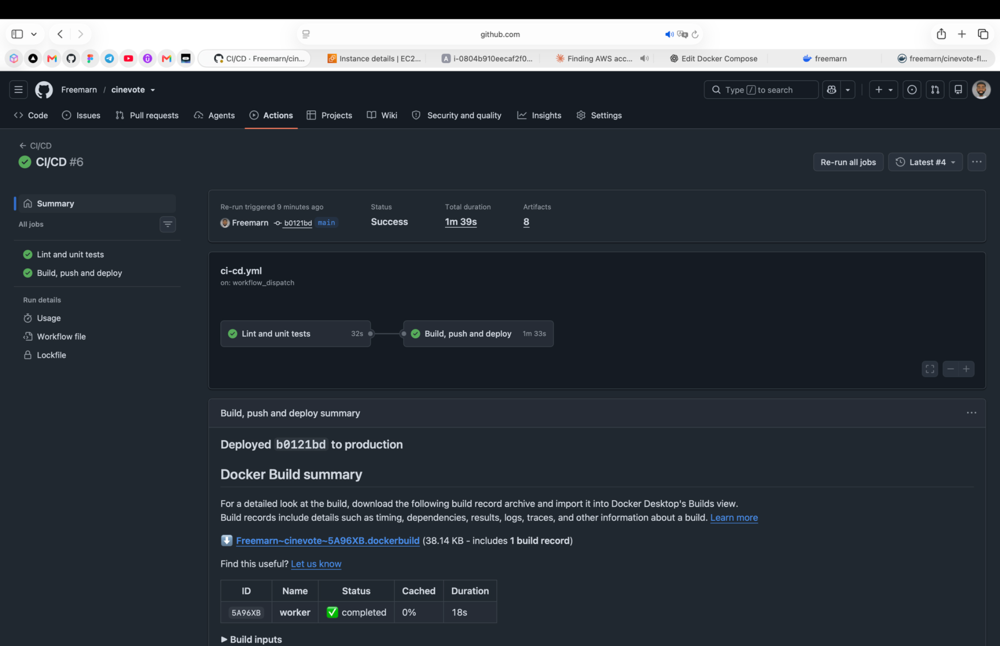

*Figure 5 — A green run in the **Freemarn/cinevote** repository. The workflow, run `#6`, was triggered
by `workflow_dispatch` on `main` from commit `b0121bd` and completed in **1 m 39 s**, with both jobs
passing: **Lint and unit tests** (32 s) and **Build, push and deploy** (1 m 33 s). The summary reports
`Deployed b0121bd to production` — the Deploy Success branch.*

*Figure 6 — The Docker build summary attached to the same run: the `worker` image, ID `5A96XB`,
**completed**, 0% cached, 18 s.*

### 12.6 Evidence: the deploy on the servers

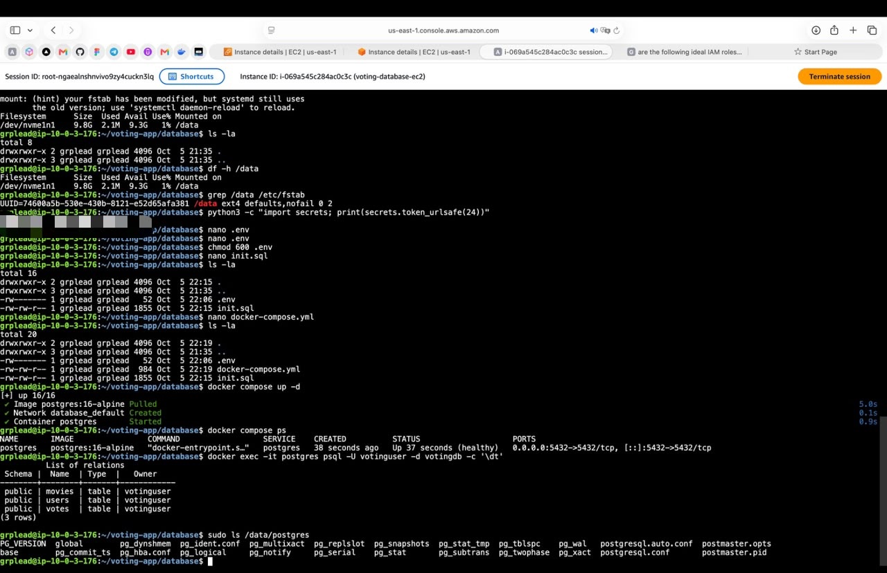

*Figure 7 — **`voting-database-ec2`** (`i-069a545c284ac0c3c`, private `10.0.3.176`). The 10 GiB EBS
volume is mounted at `/data` — `9.8G` total, `9.3G` available — and confirmed in `/etc/fstab` by UUID.
The `.env` file is in place and locked down with `chmod 600`. `docker compose up -d` pulls
`postgres:16-alpine` and starts the container, which reports **Up 38 seconds (healthy)** with
`0.0.0.0:5432->5432/tcp` and `[::]:5432->5432/tcp`. `psql -U votinguser -d votingdb -c '\dt'` lists the
schema — `movies`, `users`, `votes` — and `sudo ls /data/postgres` shows the data directory populated
with `pg_wal`, `pg_hba.conf` and the rest.*

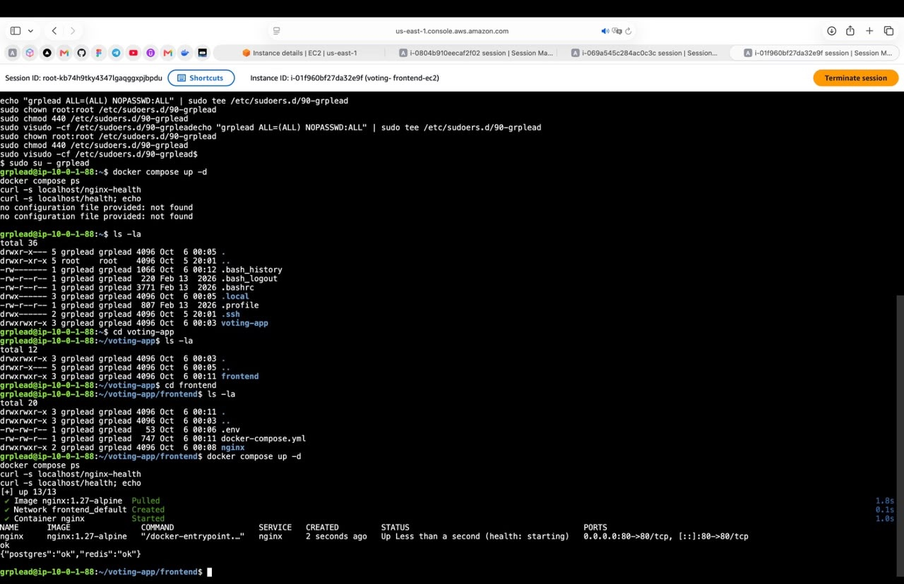

*Figure 8 — **`voting-frontend-ec2`** (`i-01f960bf27da32e9f`, private `10.0.1.88`). The deploy user
`grplead` is created with passwordless sudo via `/etc/sudoers.d/90-grplead`, then added to the `docker`
group and switched to with `sudo su - grplead`. `~/voting-app/frontend` holds `.env`,
`docker-compose.yml` and `nginx/`. `docker compose up -d` starts Nginx — **Up Less than a second
(health: starting)** on `0.0.0.0:80->80/tcp` — and the two smoke tests return
`{"postgres":"ok","redis":"ok"}`.*

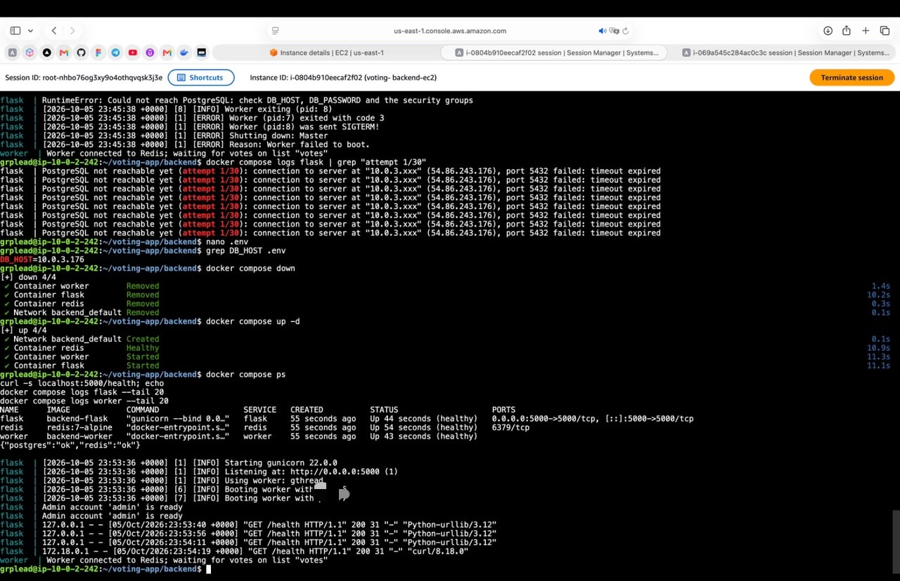

*Figure 9 — **`voting-backend-ec2`** (`i-0804b910eecaf2f02`, private `10.0.2.242`). The top of the log
shows the failure that sent you here: `RuntimeError: Could not reach PostgreSQL: check DB_HOST, DB_PASSWORD
and the security groups`, then a flood of `PostgreSQL not reachable yet (attempt 1/30) ... port 5432
failed: timeout expired`. Checking `DB_HOST` in `.env` and correcting it, then `docker compose down`
followed by `docker compose up -d`, brings all four containers up — **worker**, **flask**, **redis** and
**postgres** each **Up … (healthy)** on ports 5000 and 6379. Gunicorn starts on `http://0.0.0.0:5000`,
the admin account is seeded, and the `/health` requests log `200 OK`. The last line confirms the queue is
live: `Worker connected to Redis; waiting for votes on list "votes"`.*

---

## 13. Security


*Figure 10 — Secrets handling, IAM scope, network restrictions and container hardening, from the lower
half of the CI/CD source page.*

**One IAM role for the servers.** `CineVote-EC2-Role` carries exactly two AWS-managed policies —
`AmazonSSMManagedInstanceCore` and `CloudWatchAgentServerPolicy` — and is attached to all three
instances.

| Policy | Used by | Allows |
|--------|---------|--------|
| `AmazonSSMManagedInstanceCore` | the SSM agent preinstalled on Ubuntu (as a snap) | registering with Systems Manager, so **Connect → Session Manager** works without SSH, keys or public IPs |
| `CloudWatchAgentServerPolicy` | the Docker log driver and the health-metric script | creating log groups and streams, writing log events, and `PutMetricData` for custom metrics |

An IAM role is a set of permissions a server *wears*. AWS hands the server short-lived credentials
through its metadata service and rotates them automatically — you never paste access keys onto a server,
so there is nothing to leak if someone reads your files. Least privilege: no S3, no EC2 control, no IAM,
no admin. **A compromised container cannot delete your infrastructure.** One role for three servers is
simpler to audit than three roles.

Avoid `aws configure` or access keys on servers, even for testing. If you forget to attach the role at
launch, fix it later with `EC2 → select instance → Actions → Security → Modify IAM role`, then reboot
so the SSM agent picks it up.

**Network**

- Postgres 5432 and Redis 6379 are never exposed to the public internet; Redis is never exposed to the
  VPC at all
- SSH to private instances only through the jump host, and only from the admin's IP
- Port 22 on the frontend is opened for the GitHub runner's IP for the duration of a deploy, then closed
  by an `if: always()` step

**Secrets**

- No secrets in Git: `.gitignore` blocks `.env` and `.env.example` documents the placeholders
- Real values are written on the servers (`.env` at `chmod 600`) and injected as GitHub Actions secrets
- Two Docker Hub tokens with different rights: a **Read & Write** token for GitHub, and a **Read only**
  token on the backend. If the server is ever compromised, its token cannot overwrite your images
- The deploy SSH key's private half exists only in a GitHub secret; it is deleted from the frontend once
  it is saved

**Application and containers**

- Passwords hashed with Werkzeug; every form carries a CSRF token; cookies are HTTP-only; the post-login
  redirect only accepts local paths
- Internal Docker network only — Postgres and Redis are not published; containers run as non-root users
- One vote per user per week is enforced three times, including a PostgreSQL constraint, so a race
  between Flask and Redis still cannot double-count

---

## 14. Monitoring, logs and alarms

### 14.1 Health checks

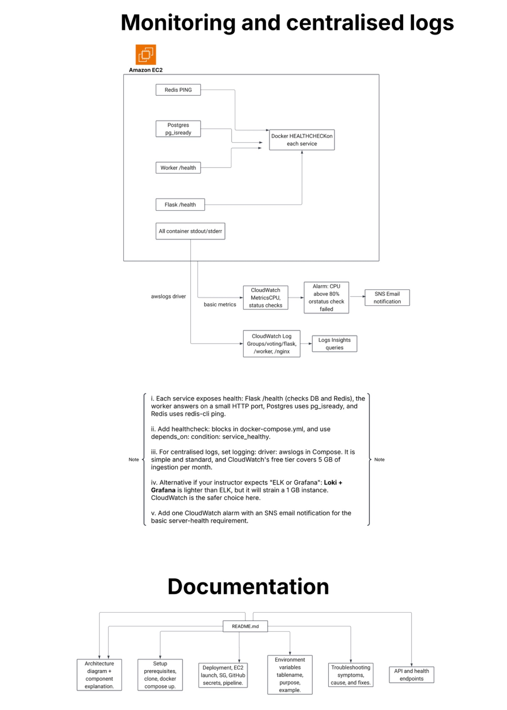

*Figure 11 — Health checks, metrics, logs and alarms on the EC2 host.*

| Container | Healthcheck | Healthy means |
|-----------|-------------|---------------|
| `postgres` (database server) | `pg_isready` | PostgreSQL accepts connections |
| `redis` | `redis-cli ping` | Redis answers `PONG` |
| `flask` | HTTP `GET /health` | Flask runs **and** reaches Redis and PostgreSQL — a 503 makes the check fail |
| `worker` | heartbeat file younger than 30 s | the processing loop is still turning |
| `nginx` (frontend server) | HTTP check on `/nginx-health` | Nginx is serving |

`depends_on: condition: service_healthy` only works between containers in the *same* compose file.
PostgreSQL lives on another server, so the code handles that dependency itself: **Flask retries the
database for 60 seconds at startup, and the worker re-queues votes until PostgreSQL is back.**

`/health` on the frontend returns 200 only when the request made it Nginx → Flask → Redis and
PostgreSQL and back. That single endpoint is what the pipeline's smoke test asserts on.

### 14.2 CloudWatch logs and metrics

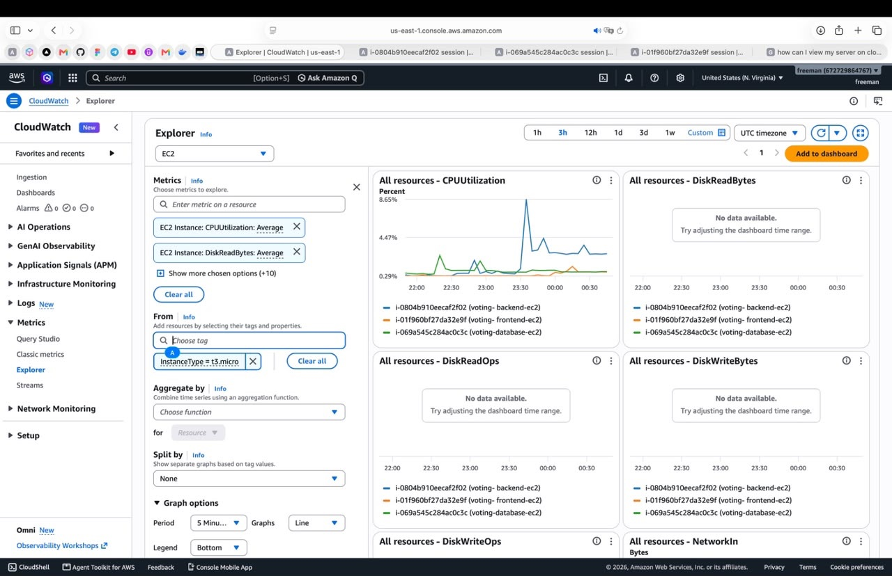

*Figure 12 — CloudWatch Explorer in us-east-1, filtered to `InstanceType = t3.micro`. The
`CPUUtilization` panel charts all three instances together — `voting-backend-ec2`
(`i-0804b910eecaf2f02`), `voting-frontend-ec2` (`i-01f960bf27da32e9f`) and `voting-database-ec2`
(`i-069a545c284ac0c3c`) — at a 5-minute period with line graphs. The disk panels
(`DiskReadBytes`, `DiskReadOps`, `DiskWriteBytes`, `DiskWriteOps`, `NetworkIn`) read **No data
available**: those are not published on this instance type without the CloudWatch Agent.*

**Log groups.** Container logs are already flowing to CloudWatch because every compose file uses the
`awslogs` driver. Three groups exist: `/voting/flask`, `/voting/worker`, `/voting/nginx`, each with one
log stream per container. Retention is set to 1 week on each group — the default is to keep logs
forever, which slowly costs money.

A useful Logs Insights query, run against `/voting/worker`, counts saved votes per hour straight from
the worker's own log lines.

**The custom health metric.** Docker knows which containers are `unhealthy`, but CloudWatch does not. A
five-line script, run every minute by cron on **all three servers**, publishes that count as a metric
under the namespace `VotingApp/Server`. The script adds `/snap/bin` to its `PATH` because cron does not
search there by default, and it uses the instance role automatically. A test run prints nothing on
success; an error means the IAM role is missing.

### 14.3 Alarms and email

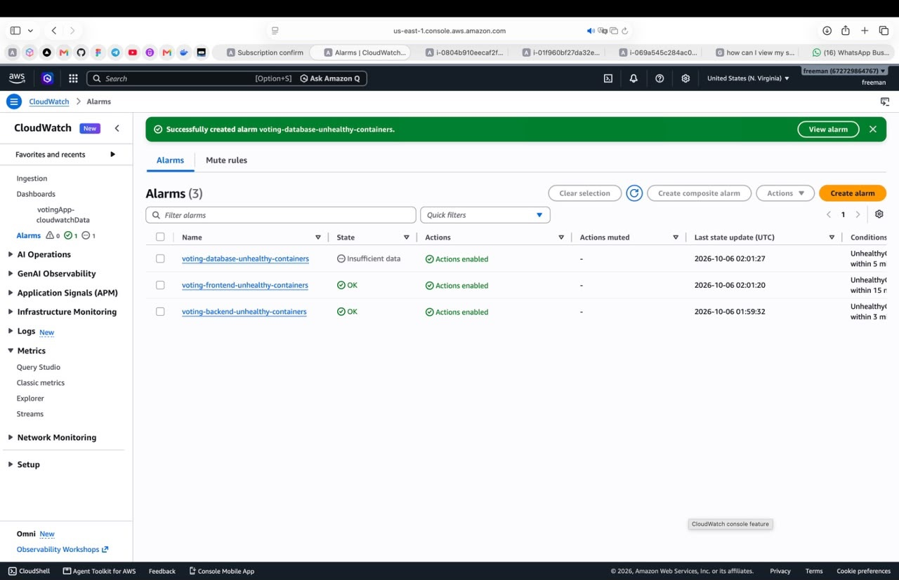

*Figure 13 — The three per-server alarms: `voting-database-unhealthy-containers`,
`voting-frontend-unhealthy-containers` and `voting-backend-unhealthy-containers`, all with actions
enabled. This capture was taken while the database alarm was in **Insufficient data** (15:27), with the
frontend and backend alarms **OK**. The console banner confirms the creation of the database alarm.*

Each alarm is built from the custom metric: statistic `Maximum`, period `1 minute`, condition
`GreaterThan 0`, with **Datapoints to alarm = 3 of 3** so a container that is briefly restarting does
not page you. In alarm state sends to the `voting-app-alerts` SNS topic.

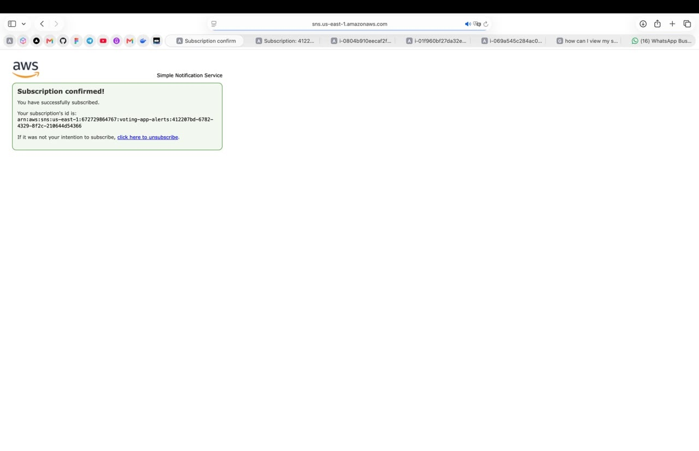

*Figure 14 — The email subscription to `voting-app-alerts` is confirmed — subscription ARN
`arn:aws:sns:us-east-1:672729864767:voting-app-alerts:412207bd-6782-4329-8f2c-218644d54366`. Alarms
cannot email you until this is confirmed, so an alarm firing now actually reaches an inbox.*

| Alarm | Fires when | Typical cause |
|-------|-----------|---------------|
| `voting-<tier>-unhealthy-containers` | a container is unhealthy for 3 minutes | Flask cannot reach PostgreSQL, worker loop stuck, Nginx down |
| EC2 status check alarm (one per server) | AWS or the OS cannot reach the instance | server out of memory, hardware fault |

That is 6 custom metrics and 6 alarms — inside the CloudWatch free allowance of 10 each.

---

## 15. API and health endpoints

| Method | Path | Purpose | Typical response |
|--------|------|---------|------------------|
| `GET` | `/` | The ballot: last week's winner, movie cards, live leaderboard, Hall of Fame | HTML (login redirect if logged out) |
| `GET`/`POST` | `/login`, `/register` | One template serves both; Flask passes `mode` | HTML |
| `POST` | `/vote` | Cast a vote — CSRF-protected | Redirect with a flash message |
| `GET` | `/admin` | Admin dashboard | HTML, or **403 Forbidden** for non-admins |
| `POST` | `/admin/movies` | Add or hide a movie | Redirect |
| `GET` | `/logout` | Clear the session | Redirect |
| `GET` | `/health` | Liveness of **both** Redis and PostgreSQL | `{"postgres":"ok","redis":"ok"}`, or **503** when either is down |
| `ANY` | `/nginx-health` | Nginx liveness (frontend) | `200 OK` |

`/health` is the contract the pipeline's smoke test depends on: it returns 200 only when both datastores
answer.

---

## 16. Testing

**Flask — 11 tests (`flask-app/tests/`), no database required.** `conftest.py` provides fake settings so
`app.py` loads without a database, defines small fakes standing in for PostgreSQL and Redis, and writes
straight into the login cookie so a test can be "logged in" without a real password check.

| Test | What it protects |
|------|------------------|
| Week rollover (2 tests) | Weeks roll over on ISO weeks, including the year boundary |
| Login and register pages | The pages render, so the templates are not broken |
| Home page needs login | Logged-out users are sent to the login page |
| Form without a CSRF token | Forged form posts are refused with 400 |
| Vote goes onto the queue | A vote is pushed to the Redis `votes` list, not written to PostgreSQL |
| Only one vote per user | The second vote in a week never reaches the queue |
| Admin forbidden for a normal user | `/admin` returns 403 to non-admins |
| Health ok and health down | `/health` gives 200 only when both Redis and PostgreSQL answer |

**Worker — 6 tests (`worker/worker.test.js`).** The worker's logic moved into two functions,
`processVote()` and `run()`. `processVote()` receives the database and cache as arguments, so a test can
pass in fakes; the Redis and PostgreSQL connections are made inside `run()`, which only executes when the
file is started directly. A test that loads the file therefore connects to nothing. Jest's
`jest.fn()` creates a fake function that records how it was called, and the tests assert the worker sent
the right SQL values and cleared the right cache key — exactly the "worker writes to PostgreSQL, then
clears the cache" rule from the architecture.

Run them the same way the pipeline does:

```bash
# Flask
pip install -r requirements-dev.txt
flake8 flask-app
pytest flask-app/tests -v

# Worker
cd worker && npm install
npx eslint .
npx jest
```

---

## 17. Application walkthrough

From here on you never copy code onto a server. You change it on GitHub, in a **pull request**: a
proposed change on its own branch that the pipeline tests before it can reach `main`. Merging the PR
deploys it.

1. On github.com, open the file and click the pencil (**Edit this file**).
2. Make your change; for a first try, change the heading text.
3. `Commit changes…` → **Create a new branch for this commit and start a pull request** → **Propose
   changes** → **Create pull request**.
4. At the bottom of the PR, **Lint and unit tests** runs. Only the test job runs on a PR; nothing is
   deployed.
5. On a green ✓, **Merge pull request** → **Confirm merge**, then **Delete branch**.
6. The merge is a push to `main`, so the Actions tab starts a full run: test, build, push, deploy. About
   5 minutes later the change is live.

For bigger edits, press `.` (the full stop key) on the repository page to open **github.dev**, a full
code editor in the browser; commit to a new branch from its Source Control panel, then open a PR.

**Protect `main`.** A ruleset makes GitHub enforce the Test Pass? box: a PR with a red ✗ cannot be
merged, and nobody can push straight to `main`. Add a branch ruleset targeting the default branch with
*Require a pull request before merging* (0 required approvals, since you work alone), *Require status
checks to pass* → `test`, and *Block force pushes*. The check name only appears after it has run once.
Rulesets are free on public repositories; on a free private repository they are not enforced.

**Roll back by hand, or redeploy.** Run the pipeline again without a code change — `Actions → CI/CD →
Run workflow → main → Run workflow` — which is also how you redeploy after resuming your AWS setup. To
go back to a specific earlier version on `voting-backend`, set `IMAGE_TAG` in `.env` to a tag from the
history and `docker compose up -d`. Every tag stays on Docker Hub, so the server downloads it again if
it has been cleaned up; the next merge to `main` deploys over it as usual.

---

## 18. Testing

The screenshots below are the running application, reached over the frontend's public IP
(`http://3.235.168.246`). The browser marks it **Not Secure** because the app is served on HTTP — port 443
is open in the security group but nothing listens on it until a certificate is installed.

### 18.1 The voter's view

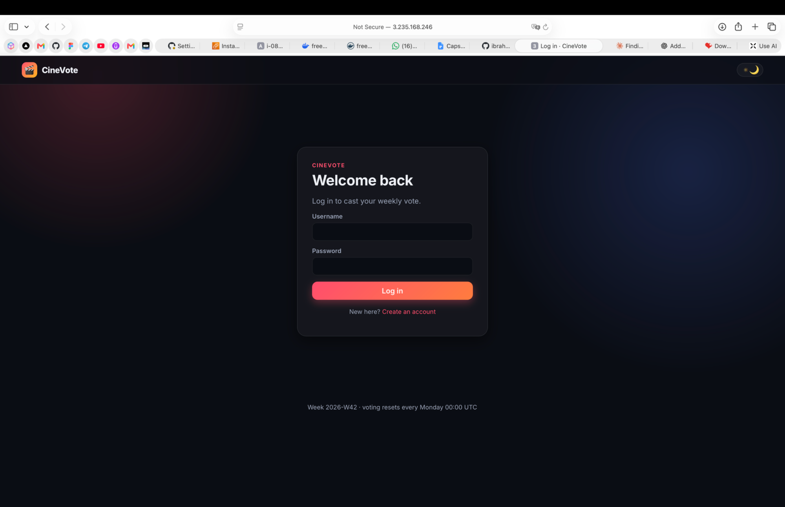

*Figure 15 — **The login page.**&nbsp; Dark mode, with the animated gradient background, the CineVote
wordmark and the moon toggle in the top-right. The card is centred: "Welcome back", one username field,
one password field, a full-width **Log in** button, and a "New here? **Create an account**" link. The
footer reads **Week 2026-W42 · voting resets every Monday 00:00 UTC** — the ISO week and rollover rule
rendered straight from the app's own logic.*

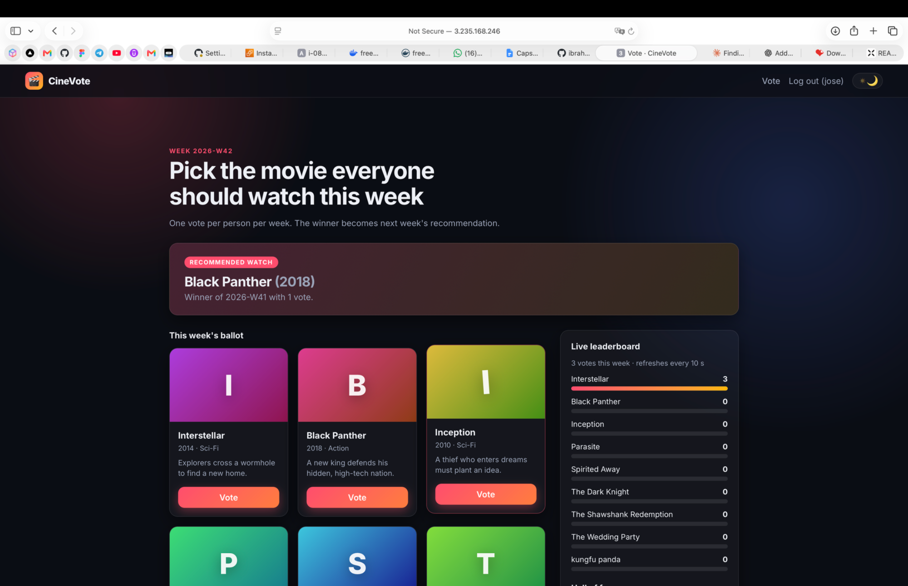

*Figure 16 — **The this-week's ballot page**, as a logged-in voter (`jose`). At the top the
**RECOMMENDED WATCH** banner shows **Black Panther (2018) — Winner of 2026-W41 with 1 vote**, which is
last week's winner automatically promoted. Below it, "This week's ballot" shows movie cards with a
coloured initial, title, year and genre, a one-line description, and a **Vote** button — `Interstellar`
(2014 · Sci-Fi), `Black Panther` (2018 · Action), `Inception` (2010 · Sci-Fi), with `Parasite`,
`Spirited Away` and `The Dark Knight` continuing below. The **Live leaderboard** panel on the right reads
"3 votes this week · refreshes every 10 s" and shows Interstellar on 3 with an orange bar, everything
else on 0. The nav bar shows **Vote**, **Log out (jose)** and the theme toggle.*

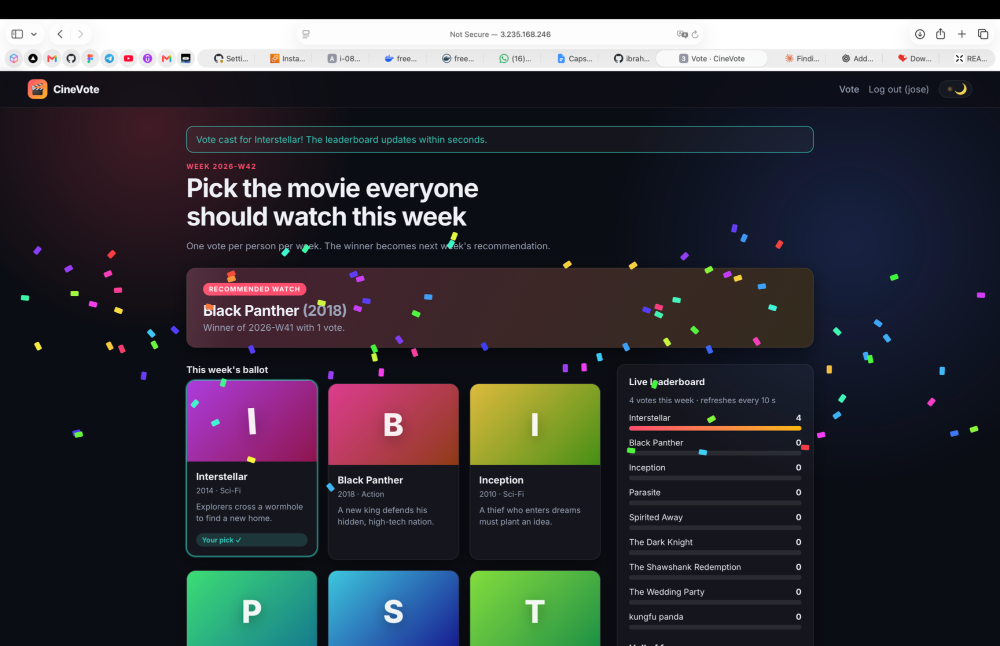

*Figure 17 — **Immediately after voting.** A green confirmation banner reads "Vote cast for Interstellar!
The leaderboard updates within seconds." Confetti falls across the page, the Interstellar card is
outlined in green with a **"Your pick ✓"** badge where its Vote button was, and the other cards' Vote
buttons are gone. The leaderboard has already moved to **4 votes this week** with Interstellar on 4 — the
10-second cache refreshing. The header now shows **Log out (jose)**, confirming the session.*

### 18.2 The admin view

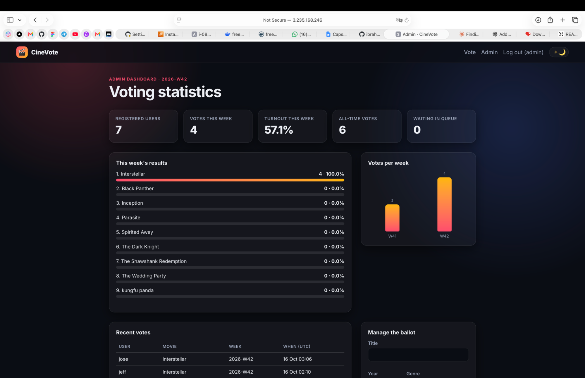

*Figure 18 — **The admin dashboard.** The nav bar gains an **Admin** link and reads **Log out (admin)**.
The five stat tiles are **Registered users 7**, **Votes this week 4**, **Turnout this week 57.1%**,
**All-time votes 6** and **Waiting in queue 0** — that last one being the live Redis `LLEN` of the
`votes` list, which is 0 here because the worker has already drained it. "This week's results" lists all
nine movies ranked, Interstellar at 4 · 100.0%, the rest at 0 · 0.0%, each with a proportional bar. The
**Votes per week** panel plots W41 at 2 and W42 at 4 as gradient bars.*

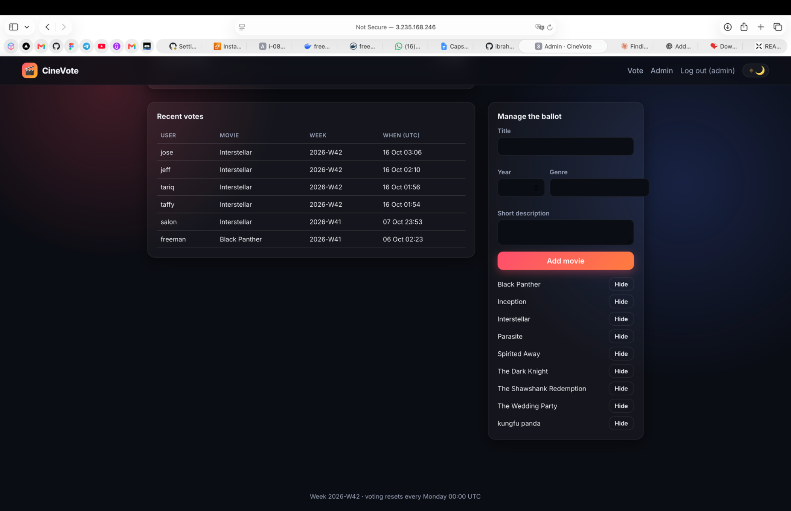

*Figure 19 — **The lower half of the same dashboard.** **Recent votes** is a table of USER, MOVIE, WEEK
and WHEN (UTC): `jose` Interstellar 2026-W42 16 Oct 03:06; `jeff` Interstellar 16 Oct 02:10; `tariq`
Interstellar 16 Oct 01:56; `taffy` Interstellar 16 Oct 01:54; `salon` Interstellar 2026-W41 07 Oct
23:53; `freeman` Black Panther 2026-W41 06 Oct 02:23 — the whole vote history, each row written by the
worker after a `BRPOP`. **Manage the ballot** offers Title, Year, Genre and Short description fields with
an **Add movie** button, and below it every movie in the catalogue with a **Hide** button. The footer
repeats **Week 2026-W42 · voting resets every Monday 00:00 UTC**.*

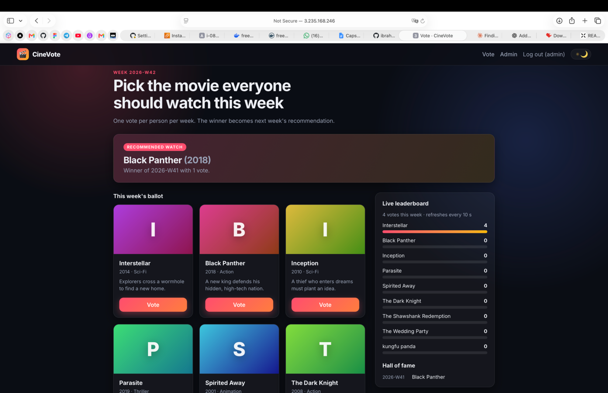

*Figure 20 — **The bottom of the leaderboard panel: the Hall of Fame.** Below the full ranked
leaderboard — Interstellar 4, then Black Panther, Inception, Parasite, Spirited Away, The Dark Knight,
The Shawshank Redemption, The Wedding Party and kungfu panda all on 0 — a **Hall of fame** section lists
`2026-W41 · Black Panther`. Past winners accumulate here one row per week. Because the interceptor shows
the admin is still logged in, this view is available to admins and voters alike.*

**What these six screenshots prove end to end:** a real login session, the ISO week rendered from the
app's own clock, the recommended-watch promotion of last week's winner, a vote accepted and confirmed in
the UI, the leaderboard updating from the 10-second Redis cache, the Redis queue depth surfaced in the
admin dashboard, the worker's writes visible as timestamped rows in `Recent votes`, and ballot
management. Together they exercise every tier: Nginx → Flask → Redis → worker → PostgreSQL.

---

## 19. Troubleshooting

**Server and container problems**

| Symptom | Likely cause | Fix |
|---------|--------------|-----|
| Session Manager says the agent is not online | IAM role missing, or a private server has no route to the NAT gateway | Attach the role and reboot; check the private route table points at the NAT gateway |
| Still `ssm-user` after `sudo su -` | The session was not elevated | Run `sudo su -` |
| Launch script failed | The script stopped at its first error | Read `/var/log/cloud-init-output.log`; the last lines name the step that failed |
| Docker cannot write to CloudWatch | The IAM role is not attached | Attach the role, then run the container again |
| Browser spins, then times out | Frontend security group or route table | `voting-frontend-sg` allows HTTP 80 from `0.0.0.0/0`; `voting-public-rt` has `0.0.0.0/0 → voting-igw`; you used HTTP, not HTTPS |
| Nginx cannot reach Flask | Wrong `API_URL`, missing port 5000 rule, or Flask unhealthy | Check `.env`, the port 5000 rule, and `docker compose ps` on the backend |
| Flask logs `Could not reach PostgreSQL` (as in Figure 9) | Wrong `DB_HOST`, wrong password, or a missing SG rule | Fix `.env`, check port 5432 from `voting-backend-sg` |
| `postgres` unhealthy after changing the DB password | `POSTGRES_PASSWORD` only applies the first time the volume is created | Put the original password back in both files, or `docker compose down -v` (losing all data) |
| Votes accepted but never counted | Worker stopped or failing | `docker compose ps` and `docker compose logs worker`; `LLEN votes` in Redis shows the backlog |
| Image build killed or very slow | Out of memory on the t3.micro | Check `free -h`; build again with `DOCKER_BUILDKIT=0` |
| "Form expired" error | The page was open across a login or logout | Refresh the page and submit again |
| A command is "not found" from cron | Cron does not search `/snap/bin` | The health script adds it to its `PATH` |

**Pipeline problems** — open the failed run in the Actions tab, click the red job, then the red step; its
last lines nearly always name the problem.

| Failed step | Cause and fix |
|-------------|---------------|
| `git push` | You typed your GitHub password — paste the fine-grained token instead. Expired? Make a new one. |
| `git push` (workflow file refused) | The token lacks **Workflows: Read and write**. Edit the token, add it, push again. |
| `git push` (repo not empty) | A README was added at creation. Run `git pull --rebase`, then push. |
| Lint: flake8 | The file and line are printed. Fix that line; `.flake8` must be in the repository root. |
| Unit tests: pytest | `requirements-dev.txt` is missing a package, or `conftest.py` is not in `flask-app/tests/`. |
| Lint: eslint | `eslint.config.js` must sit inside `worker/`. |
| Unit tests: jest | `worker.js` and `worker.test.js` must sit together in `worker/`. |
| Log in to Docker Hub | The variable or secret is wrong, or the token is read-only. Use the Read & Write token. |
| Docker build and push | The Docker Hub repository name differs, or the token is not Read & Write. |
| Sign in to AWS | The role's trust policy does not match: check the `sub` line has your exact GitHub username and branch, and that `id-token: write` is in the workflow. |
| Find the frontend and open SSH | Your AWS setup is paused — resume it, then **Run workflow**. |
| Find the frontend and open SSH | The inline policy's resource has the wrong account ID or security group ID. |
| Set up the SSH key (`Permission denied (publickey)`) | The key in the secret is incomplete (copy from `BEGIN` to `END`), or the public key is not in `authorized_keys` on **both** servers. |
| Set up the SSH key (keys are right, still refused) | The account may be locked for SSH. On that server run `sudo passwd -u ubuntu` — this unlocks key logins and still allows no password logins. |
| Set up the SSH key (frontend unreachable) | The previous step did not add the rule, or `voting-backend-sg` lacks inbound SSH 22 from `voting-frontend-sg`. |
| SSH to EC2 … (`IMAGE_TAG` not found) | Add the two image lines to the backend's `.env`. |
| SSH to EC2 … (image not found / wrong tag) | The images were not pushed, or `IMAGE_TAG` on the backend differs from GitHub's. Nothing changed on the server. |
| SSH to EC2 … (pull limit) | Docker Hub pull limit reached; sign Docker in with the read-only token on the backend. |
| SSH to EC2 … (rolled back) | The rollback worked as designed. The Flask log lines just above show why the new version was unhealthy. |
| SSH to EC2 … (smoke test failed, not the new code) | The server itself has a problem — database server down, disk full. On the backend: `docker compose ps`, `df -h`, `docker compose logs`. |
| Smoke test through Nginx (`000` or 502) | The backend is healthy but Nginx isn't. On the frontend: `docker compose ps` and `docker compose logs nginx`. |
| Close SSH again (any error) | Harmless, but check `voting-frontend-sg` and delete any leftover SSH rule for an unknown IP. |

Two commands answer most questions: `docker compose ps` (is it running and healthy?) and
`docker compose logs <service>` (what did it say?). Both work while the logs also flow to CloudWatch.

**Seeing the two branches happen.** To watch **Fail PR, notify**, add an unused variable under an
existing line in `worker.js`, open a PR: lint fails, the PR shows ✗, your ruleset blocks the merge, and
you get an email — nothing was built or deployed. To watch **Rollback to previous tag**, change Flask's
port in the Dockerfile: the tests pass (unit tests cannot see it) so the merge deploys, the smoke test
fails, `docker compose ps` shows the wrong `IMAGE_TAG`, and the run ends red. During the roughly 90
seconds of the failed attempt the site returns 502, then comes back on the old version by itself.

---

## 20. Cost and cleanup

The NAT gateway and running instances cost money every hour, even with nobody voting. Pause when you
stop working for more than a day, and delete everything when the project is finished.

**Pause (keeps your data and setup).** Stop all three instances (`Instance state → Stop instance`) —
stopped instances cost nothing for compute, though their disks still cost about $3/month. Then delete
the NAT gateway and release its Elastic IP. To resume: recreate the NAT gateway, point
`voting-private-rt`'s `0.0.0.0/0` route at the new one (the old target will show as `blackhole`), and
start the three instances. Every container restarts on its own and `/data` remounts from `/etc/fstab`.
The frontend gets a new public IP — read it from the Details tab.

**Delete everything, in this order.** Dependencies force it: a VPC cannot be deleted while instances or
a NAT gateway still use it.

1. Terminate all three instances
2. Delete the leftover 10 GiB data volume once its state is `available` (it was set not to delete on termination)
3. Delete the NAT gateway; wait until it shows `deleted`
4. Release the NAT's Elastic IP (and any you made for the frontend)
5. Delete the VPC — this also deletes its subnets, route tables, internet gateway and security groups
6. Delete the three CloudWatch log groups, the alarms and the status check alarms
7. Delete the SNS topic
8. Optional: delete the IAM role and the `voting-key` key pair (roles cost nothing)

Leave the budget in place; it costs nothing and protects future projects.

**Tokens and keys to look after**

| Item | Where it lives | Lifetime | When to replace |
|------|----------------|----------|-----------------|
| GitHub fine-grained token | nowhere after the first push | 7 days | delete it after the first push |
| Docker Hub Read & Write token | GitHub secret | until you delete it | if it may have leaked |
| Docker Hub read-only token | on the backend | until you delete it | same, then sign in again on the backend |
| Deploy SSH key | private half: GitHub secret; public half: `authorized_keys` on frontend and backend | no expiry | repeat the key steps with a new key, update the secret, delete the old line from both files |
| AWS access | nothing stored; temporary credentials per run | 1 hour | nothing to rotate |

If GitHub ever shows a secret value in a log by mistake, treat it as leaked and replace it.

---

## 21. Screenshot index

| # | File | Shows |
|---|------|-------|
| 1 | `assets/01-architecture-diagram.jpeg` | Full architecture: VPC, subnets, containers, CI/CD and monitoring paths |
| 2 | `assets/02-cicd-and-security.jpeg` | CI/CD pipeline flow and the three security groups |
| 3 | `assets/03-monitoring-and-documentation.jpeg` | Health checks, CloudWatch telemetry, and the documentation tree |
| 4 | `assets/04-cloudwatch-metrics.jpeg` | CloudWatch metrics explorer filtered to `t3.micro` |
| 5 | `assets/05-cloudwatch-alarms.jpeg` | Three per-server unhealthy-container alarms |
| 6 | `assets/06-sns-subscription-confirmed.jpeg` | Confirmed SNS email subscription for `voting-app-alerts` |
| 7 | `assets/07-database-ec2-terminal.jpeg` | Database server: EBS mount, `.env` at 600, Postgres healthy, schema listed |
| 8 | `assets/08-frontend-ec2-terminal.jpeg` | Frontend server: deploy user, Nginx healthy, smoke tests passing |
| 9 | `assets/09-backend-ec2-terminal.jpeg` | Backend server: the DB connection error, the fix, all containers healthy |
| 10 | `assets/10-github-actions-run.png` | Green GitHub Actions run with the Docker build summary |
| 11 | `assets/11-ui-login-dark.png` | Login page in dark mode, ISO week footer |
| 12 | `assets/12-ui-ballot.png` | The ballot: recommended watch, movie cards, live leaderboard |
| 13 | `assets/13-ui-vote-cast-confetti.png` | A vote cast: confirmation, confetti, "Your pick ✓" |
| 14 | `assets/14-ui-admin-dashboard.png` | Admin dashboard: five stat tiles, results, votes-per-week chart |
| 15 | `assets/15-ui-admin-recent-votes-manage.png` | Admin: recent votes table and ballot management |
| 16 | `assets/16-ui-hall-of-fame.png` | Ranked leaderboard with the Hall of Fame |

Figures 1–2 share `assets/01-architecture-diagram.jpeg`, and Figures 3, 4 and 10 share
`assets/02-cicd-and-security.jpeg` — each source page carries two drawings.

---

**At the end you have:** a VPC with one public and two private subnets, an internet gateway, a NAT
gateway and two route tables; three chained security groups and one least-privilege IAM role shared by
all servers; a Nginx reverse proxy → Flask API → Redis list queue → Node.js worker → PostgreSQL on its
own EBS disk, with a 10-second leaderboard cache; login, one vote per user per week, a live leaderboard,
a weekly recommendation, an admin dashboard and light/dark mode with animations; Docker healthchecks on
all five containers, logs and a health metric in CloudWatch, and email alarms; and a pipeline that lints
and tests every push, deploys `main` to the servers, smoke tests the result, and rolls itself back when
a deploy goes wrong.
